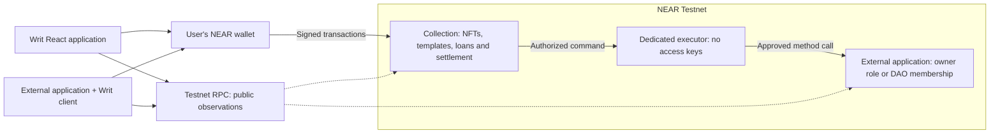

<p align="center">
  
</p>

<h1 align="center">Writ</h1>

<p align="center">
  
  
  
  
</p>
<p align="center">
  
  
  
  <a href="LICENSE"></a>
</p>

<p align="center"><strong>Hand over the keys. Keep no spares.</strong></p>

<p align="center">
  Transfer an NFT. Transfer who can exercise an on-chain role.<br />
  Inspect its authority, delegate exact commands, and hand control to the next holder.
</p>

<p align="center">
  <a href="#getting-started">Getting started</a> &middot;
  <a href="#how-writ-works">How it works</a> &middot;
  <a href="#supported-integrations">Integrations</a> &middot;
  <a href="#architecture">Architecture</a> &middot;
  <a href="#deployment">Deployment</a> &middot;
  <a href="#license">License</a>
</p>

---

## Contents

- [Overview](#overview)
- [How Writ works](#how-writ-works)
- [Supported integrations](#supported-integrations)
- [Architecture](#architecture)
- [Technology stack](#technology-stack)
- [Getting started](#getting-started)
- [Configuration](#configuration)
- [Transfers, lending and settlement](#transfers-lending-and-settlement)
- [NFT artwork and wallets](#nft-artwork-and-wallets)
- [Integrating another application](#integrating-another-application)
- [Development and validation](#development-and-validation)
- [Deployment](#deployment)
- [Repository structure](#repository-structure)
- [Documentation](#documentation)
- [Security and data handling](#security-and-data-handling)
- [Contributing](#contributing)
- [License](#license)
- [Third-party notices](#third-party-notices)

## Overview

Writ turns supported on-chain roles into transferable NFTs. A service owner, collection administrator, token issuer, treasury controller or DAO council member can place a compatible role under a dedicated **keyless NEAR executor account**. The NFT determines who may instruct that executor through the role's approved commands.

The external application continues to enforce its permissions on-chain. Writ's website provides an interface to those contracts; another application can use the same controller through the standalone integration client.

Built for NEAR's **NFTs That Do Something** track: ownership with behavior, beyond a collectible image. The current release runs on **NEAR Testnet**.

| Capability             | What it does                                                                                                                                   |
| ---------------------- | ---------------------------------------------------------------------------------------------------------------------------------------------- |
| Role wrapping          | Creates an NFT and executor, then guides the existing administrator through granting and verifying the external role.                          |
| Direct handover        | Transfers the NFT without requiring a listing, purchase price or sale.                                                                         |
| Approved commands      | Lets the current holder exercise the methods declared by the pinned integration template.                                                      |
| Scoped delegation      | Lends a permitted command with exact arguments, an expiry and revocation. Transfer invalidates existing delegations.                           |
| Conditional purchases  | Checks declared external conditions before settling an optional sale. Failed conditions preserve the seller's NFT.                             |
| Native-NEAR accounting | Separates executor funds, purchase refunds and seller credits, with withdrawal and failed-payment recovery paths.                              |
| Authority inspection   | Shows commands, balances, code hashes, public access-key permissions and known limits; exports the evidence as JSON.                           |
| Dynamic NFT artwork    | Renders holder and role information into standalone SVG media with a verified SHA-256 hash.                                                    |
| Verified hand-back     | Returns a supported Owner role to the holder's wallet, verifies the result, retires the NFT and exposes remaining executor funds for recovery. |
| External integration   | Supplies a dependency-free TypeScript client and a separate application with its own wallet connection.                                        |

## How Writ works

Consider Ada, who owns a compatible application, and Ben, who will take over.

1. **Choose the role.** Ada connects her testnet wallet, selects a supported profile and enters the application's account. The four Owner-based profiles also offer a compatible practice target.
2. **Mint the Writ.** Ada reviews the funding quote and signs. Writ creates the NFT and a dedicated executor account with no access keys. Minting alone does not acquire the external role.
3. **Grant and verify authority.** Ada proposes the executor as the application's owner. The executor accepts through Writ, then the declared conditions are checked. Interrupted steps resume from **My Writs**. DAO membership instead requires the DAO's existing governance.
4. **Use the role.** Ada asks the collection contract to execute an approved command. It checks her authority and forwards the call through the executor. The external application recognizes the executor as its authorized caller.
5. **Hand it over.** Ada transfers the NFT to Ben. The executor keeps the role, while Writ changes who may instruct it and invalidates previous delegations.
6. **Continue or unwrap.** Ben uses the same role from Writ or another integrated application. For supported Owner profiles, he can complete hand-back into his own wallet and retire the Writ.

After transfer, Ada cannot regain Writ authorization by opening another website or calling the collection directly: the contract checks the current holder. An independent key, role or governance permission that Ada holds outside Writ remains separate. The authority report discloses observable keys and the template's limits; it does not discover every hidden permission.

## Supported integrations

Five profiles are implemented and exercised against actual contracts.

| Profile                      | External integration                           | Available behavior                                                | Boundary                                                                                                 |
| ---------------------------- | ---------------------------------------------- | ----------------------------------------------------------------- | -------------------------------------------------------------------------------------------------------- |
| Contract owner               | Upstream `near-sdk-contract-tools` Owner 4.0.0 | Change a compatible service's price; propose ownership hand-back. | `set_price` is an application command, not part of the generic Owner interface.                          |
| DAO council seat             | Pinned, unchanged upstream Sputnik DAO v2 Wasm | Forward `act_proposal` as the executor's council membership.      | A seat is not sole DAO control. Governance approves membership and may revoke it.                        |
| NFT collection administrator | Upstream NEP-171/177/181 components with Owner | Issue a collectible through `mint_collectible`.                   | Mint administration is application-specific; arbitrary NFT collections are not automatically compatible. |
| Token issuance controller    | Upstream NEP-141/148 components with Owner     | Issue credits through `mint_tokens`.                              | Existing holders keep their balances. Issuance cannot be lent under this profile.                        |
| Treasury controller          | Native-NEAR treasury with Owner                | Make a payment through `treasury_pay`.                            | Treasury funds stay in the external target. Spending cannot be lent under this profile.                  |

The three added application profiles share the Owner primitive and verify a `get_integration_profile` marker alongside ownership conditions. Every Writ pins its template hash. Other interfaces require reviewed adapters and tests; changing a label does not establish compatibility. The staking-pool draft is not offered as a supported live integration.

For Sputnik, approve an `AddMemberToRole` proposal in the DAO's governance interface, adding the displayed executor to `council`, then confirm in Writ. Adding that membership does not automatically remove the initiating person's separate council seat.

## Architecture



| Layer                     | Responsibility                                                                                                         |
| ------------------------- | ---------------------------------------------------------------------------------------------------------------------- |
| React frontend            | Public inspection, wallet connection, guided handover, holder actions and recovery interfaces.                         |
| Collection contract       | NFT ownership, pinned templates, authorization, delegation epochs, pending-call locks, purchases and credit ledgers.   |
| Executor contract         | Accept instructions only from the collection and forward approved actions. No key, deploy or delete surface.           |
| External application      | Enforce its own ownership or governance rules and carry out the requested operation.                                   |
| Standalone client         | Pin release identities, inspect finalized state, verify artwork and prepare/confirm wallet transactions without React. |
| Test and deployment tools | Execute actual Wasm scenarios, record receipts/hashes, provision testnet examples and validate browser flows.          |

The frontend is a static application. Authorization and financial transitions execute in NEAR contracts; no application server or database is required for this release.

## Technology stack

| Area                   | Technology                                                                         |
| ---------------------- | ---------------------------------------------------------------------------------- |
| Application            | TypeScript 7, React 18, React Router 7, Vite 8                                     |
| Styling                | CSS Modules, custom CSS, SVG, Public Sans and Courier Prime                        |
| Wallet connection      | NEAR Connect, user-approved wallet signatures                                      |
| Chain transport        | `near-api-js` 7.4; standalone client using Fetch                                   |
| Contracts              | Rust 1.99.1, `near-sdk` 5.30.1, `cargo-near` 0.23.0                                |
| Integration components | `near-sdk-contract-tools` 4.0.0; pinned Sputnik DAO v2 Wasm                        |
| NFT standards          | NEP-171 core, NEP-177 metadata, NEP-181 enumeration; SVG media with `media_hash`   |
| Validation             | Vitest, Playwright, axe-core, TypeScript, Oxlint and actual NEAR sandbox execution |
| Delivery               | Static `dist` build; Vercel and Netlify routing configuration                      |

Exact versions are recorded in the npm and Cargo lockfiles. Upstream DAO provenance is recorded in [vendor-provenance.json](docs/vendor-provenance.json).

## Getting started

### Requirements

- **Node.js 24+** with npm and Git.
- A NEAR testnet wallet and testnet NEAR for signed interactions. Public inspection does not require a connected wallet.
- Chromium for browser tests.
- For contract builds and sandbox tests: Linux or WSL, the pinned [Rust toolchain](rust-toolchain.toml), and `cargo-near` 0.23.0.

### Install and run

```sh
git clone https://github.com/ELLA0VICTOR/writ.git
cd writ
npm ci
npm run dev
```

Open the URL printed by Vite, normally **http://localhost:5173**. On Windows, use `npm.cmd` or `npx.cmd` if PowerShell execution policy blocks the corresponding `.ps1` commands.

**No environment file is required to use the published testnet contracts.** A clean checkout reads the public release configuration included in source.

| Route        | Purpose                                                                         |
| ------------ | ------------------------------------------------------------------------------- |
| `/`          | Overview and links to five live integration examples.                           |
| `/app`       | Your Writs, withdrawal credits, incomplete handovers and retired-fund recovery. |
| `/market`    | Optional sale listings and public inspection.                                   |
| `/wrap`      | Select a profile, create or supply a target, mint and complete handover.        |
| `/writ/<id>` | Role conditions, authority evidence, artwork, history and available actions.    |

Add `?mock=1` for explicitly labelled examples, such as `/writ/7?mock=1`. Example mode does not execute NEAR transactions.

### Explore the testnet release

Current collection: **`writ-collection-mw5cm75f.testnet`**.

| Writ | Example                                                                                        |
| ---- | ---------------------------------------------------------------------------------------------- |
| `1`  | Compatible service ownership.                                                                  |
| `2`  | Deliberately pending successor: purchase conditions fail and the purchase price is refundable. |
| `3`  | Sputnik DAO council membership.                                                                |
| `4`  | Collection administration, including a real collectible mint.                                  |
| `5`  | Fungible-token issuance, including actual issued credits.                                      |
| `6`  | Native-NEAR treasury funding and payout.                                                       |

The live browser-rehearsal Writ `7` was deliberately unwrapped and retired. It is no longer active; the separate mock illustration still uses ID `7`. Examples may change state through genuine transactions. The [deployment manifest](deployments/testnet.json) records public identities, hashes and receipts.

## Configuration

Default release values live in [src/content/deployment.json](src/content/deployment.json). Local overrides use `.env.local`; [.env.example](.env.example) lists the supported fields.

| Variable                        | Purpose                                                                           |
| ------------------------------- | --------------------------------------------------------------------------------- |
| `VITE_NEAR_RPC_URL`             | Testnet endpoint; defaults to `https://test.rpc.fastnear.com`.                    |
| `VITE_WRIT_CONTRACT`            | Collection override. Defining it selects a complete custom release configuration. |
| `VITE_WRIT_ABI_VERSION`         | Expected collection/frontend ABI version.                                         |
| `VITE_COLLECTION_CODE_HASH`     | Pinned collection hash, checked before writes.                                    |
| `VITE_EXECUTOR_CODE_HASH`       | Expected executor code hash.                                                      |
| `VITE_OWNER_TEMPLATE_HASH`      | Contract-owner template hash.                                                     |
| `VITE_DAO_TEMPLATE_HASH`        | DAO council template hash.                                                        |
| `VITE_COLLECTION_TEMPLATE_HASH` | Collection-administrator template hash.                                           |
| `VITE_ISSUER_TEMPLATE_HASH`     | Token-issuer template hash.                                                       |
| `VITE_TREASURY_TEMPLATE_HASH`   | Treasury-controller template hash.                                                |
| `VITE_GITHUB_URL`               | Optional repository link in the interface.                                        |
| `VITE_DEMO_VIDEO_URL`           | Optional demo-video link when available.                                          |

When overriding the collection, supply the corresponding ABI and hashes from that deployment. Explicit configuration replaces the default identity rather than mixing releases. **Copying the example file with an empty `VITE_WRIT_CONTRACT` disables live transactions**; omit that variable to retain the checked-in release. Restart Vite after changing environment values.

Every `VITE_` value is public and may be embedded in the browser bundle. Never put private keys, seed phrases or provider secrets there. This frontend checks the testnet chain ID and intentionally rejects mainnet RPCs.

## Transfers, lending and settlement

### Direct transfer

The holder can transfer a Writ without selling it. The role remains assigned to the executor. NFT ownership changes, the authorization epoch advances and existing loans stop being valid. Transfers into the collection's own infrastructure namespace are rejected.

### Scoped delegation

Lendable commands bind the borrower, method, exact JSON arguments, expiry and current ownership epoch. Delegations can be revoked and permit repeated matching calls until expiry or revocation; the target may separately reject duplicates. Each Writ supports at most eight loans with bounded arguments and a maximum validity of 366 days. Issuance, treasury spending and ownership hand-back are not lendable in the corresponding profiles.

### Optional sale

Listing pauses role use, lending, withdrawals and transfers. A buyer authorizes a pinned version, template, maximum price and any selected minimum available executor balance. Settlement runs the template's declared external conditions.

- **Conditions pass:** ownership moves to the buyer and the seller receives a withdrawal credit.
- **Conditions fail:** the seller retains the NFT and the full purchase price becomes refundable.
- **Outcome unknown:** the interface retains the attempt identity and offers status/recovery operations instead of requesting a second payment.

The disclosed **0.05 NEAR retained purchase-record charge** and network fees remain spent on a refused purchase. Storage and operating reserves are excluded from withdrawable executor funds. Target treasury funds are separate from executor funds.

External checks execute asynchronously. They cover the declared predicates and do not establish a simultaneous global snapshot, absence of hidden permissions or permanent authority.

### Hand-back and retirement

Supported Owner profiles unwrap through three signed steps: propose the holder's wallet, accept ownership from that wallet, then verify the target's owner before retiring the NFT. Reopening the flow resumes incomplete steps. The last holder can recover remaining available native executor funds from **My Writs**. DAO membership has a different governance lifecycle and is not offered as this Owner hand-back flow.

## NFT artwork and wallets

Writ implements NFT core, enumeration, metadata and mint/transfer/burn events. Each token includes standalone SVG artwork and a base64 **SHA-256 `media_hash`** of the decoded image bytes. The authority panel and integration client verify that correspondence. Holder changes update the generated artwork and hash.

The detail page shows the network, collection, token ID and recorded holder so ownership can be checked independently of a wallet's Collectibles screen. Wallets may cache old artwork or index testnet NFTs at different speeds.

The signed lifecycle and collectible display were exercised through **Intear Wallet via NEAR Connect**, using generated testnet accounts. Other vendors have not completed the same signed rehearsal. See [wallet verification](docs/wallet-verification.json) and [NFT media](docs/NFT_MEDIA.md).

## Integrating another application

The [standalone client](sdk/index.ts) has no React, wallet-key or `near-api-js` dependency. Another application can inspect a Writ, verify artwork, prepare a command for its own wallet connection and confirm the final transaction.

```ts
import { WritClient } from "./sdk/index";
import release from "./src/content/deployment.json";

const client = new WritClient({
  rpcUrl: "https://test.rpc.fastnear.com",
  network: "testnet",
  collection: release.collection,
  collectionCodeHash: release.collectionCodeHash,
  executorCodeHash: release.executorCodeHash,
  templateHashes: release.templateHashes,
});

const evidence = await client.inspect("1", true);
console.log(evidence.writ.owner, evidence.nft?.metadata.title);
```

For signing, `buildAction(...)` returns a wallet-compatible transaction. The user's wallet signs it; `confirmAction(hash, signer, requestedTransaction)` checks the final successful command against the requested arguments and deposit. Contracts remain the authorization boundary even if a client reads stale state.

Run the separate example:

```sh
npm run example
```

Open **http://127.0.0.1:5174**. It has its own wallet connection and uses no Writ React components or shared application session. An actual command from this application appears in the wallet evidence. Production builds also serve the generated browser module at `/sdk/writ.js`; no npm package is claimed published.

See the [integration guide](docs/INTEGRATION_GUIDE.md) and [client reference](sdk/README.md) for compatible APIs, pinning, signing and trust boundaries.

## Development and validation

### Frontend and external application

```sh
npm test
npm run lint
npx playwright install chromium
npm run test:e2e
npm run build
npm run example:build
npm run check:secrets
```

The build runs strict TypeScript checks and enforces JavaScript bundle budgets. Browser tests cover responsive accessibility, all five profiles, wrapping, transfer, delegation, purchases, recovery and denied local credential paths. Lint exits successfully with React advisory warnings; it is not a warning-free result.

### Contracts and sandbox

Under Linux or WSL, with the pinned Rust toolchain:

```sh
npm ci
cargo install cargo-near --version 0.23.0 --locked
bash scripts/build-contracts.sh
npm --prefix integration ci
npm --prefix integration test
```

The build generates embedded media, fetches the pinned upstream DAO fixture and compiles the contracts. Contracts originate from `cargo near new` scaffolds. Builds use `cargo near build non-reproducible-wasm`; published hashes identify the tested artifacts without claiming reproducible container-build certification.

### Recorded verification

The **6 November 2026** packet records:

| Check                           | Recorded result                                                                               |
| ------------------------------- | --------------------------------------------------------------------------------------------- |
| Frontend unit tests             | 48 passed across nine files.                                                                  |
| Mock/unconfigured browser suite | 41 passed.                                                                                    |
| Actual Wasm sandbox             | 14 scenarios; 256 recorded transactions, including expected rejected attacks.                 |
| App-wallet rehearsal            | 18 verified final transaction receipts.                                                       |
| Live desktop/mobile views       | 18 route/viewport checks; no page/console errors, overflow or axe violations in tested views. |
| External application            | Real signed command, verified artwork and separate read-only browser checks.                  |
| Clean static deployment         | Real testnet reads passed without local environment files.                                    |

Sandbox scenarios include old-holder rejection, receiver rollback/reentry, pending-call locks, exact delegation, spoofed callbacks, refused sales, failed native payments, timeout recovery, late callbacks, capacity, retirement and external NFT/FT/treasury effects. These observations are not an independent audit, exhaustive schedule proof or competitor benchmark.

With production preview on port 4173, `node scripts/check-production.mjs` checks static assets and mock behavior; `node scripts/check-live.mjs` checks real public testnet views. With the separate app on 5174, use `node scripts/check-example.mjs`. `node scripts/check-published-build.mjs` checks a clean build without local environment files. Live checks depend on provider availability. See [VERIFICATION.md](docs/VERIFICATION.md) for full results and reproduction.

## Deployment

### Static frontend

Use Node.js 24+:

```sh
npm ci
npm run build
```

Publish **`dist`**. Vercel rewrites are supplied in [vercel.json](vercel.json); Netlify rewrites are supplied in [public/_redirects](public/_redirects). Default public configuration connects a clean deployment to the current testnet contracts. No signing credentials belong in the hosting environment. The development gallery is excluded from production builds.

### Fresh testnet contracts

After building artifacts and installing integration dependencies, run from a Linux/WSL shell:

```sh
WRIT_TESTNET_RELEASE=my-testnet-release node integration/deploy-testnet.mjs
```

The helper provisions testnet accounts, deploys local artifacts, exercises examples and records receipts. It journals completed operations and refuses silent upgrades. The current release label is `expanded-2026-11-06`.

Private generated account material and journals stay under ignored `.local/`. Public identities and hashes populate the manifest and frontend configuration. Faucet funding is subject to provider limits; an optional capped funding helper requires an explicit release label. Testnet tokens have no real monetary value.

### Mainnet status

**The current release is testnet-only.** Mainnet requires a separate contract review, upgrade-authority decision, network/wallet/explorer configuration, approved funding and fresh deployments. Changing only the RPC URL is insufficient. Testnet NFTs and balances do not become mainnet assets.

See [release readiness](docs/RELEASE_READINESS.md) and the dated [mainnet cost estimate](docs/mainnet-cost-estimate.json). The estimate covers a stated small deployment topology, not every demo account or an approval to spend funds.

## Repository structure

```text
writ/
├── contracts/
│   ├── collection/          NFTs, templates, authorization, settlement and factory
│   ├── executor/            Minimal keyless controller
│   ├── owner-fixture/       Compatible service, NFT, token and treasury examples
│   └── adversary/           Attack and failure fixtures
├── deployments/             Public testnet manifests and prior-release evidence
├── docs/                    Threat model, ABI, integration guides and verification
├── examples/external-app/   Separate app with its own wallet connection
├── integration/             Actual Wasm tests and testnet deployment tools
├── public/                  Favicon, brand assets and static hosting redirects
├── scripts/                 Builds, media generation, validation and secret checks
├── sdk/                     Dependency-free integration client and reference
├── src/
│   ├── chain/               Adapters, ABI bindings and validation
│   ├── components/          Shared interface components
│   ├── content/             Public release identity and evidence pointers
│   ├── features/            Actions, authority reports and recovery interfaces
│   ├── nft/                 Shared SVG renderer and font embedding
│   ├── pages/               Landing, market, holder view, wrap and NFT detail
│   └── templates/           Pinned integration definitions and registry
├── tests/                   Frontend unit and browser suites
├── .env.example             Public configuration override template
├── rust-toolchain.toml      Pinned Rust compiler and Wasm target
├── vercel.json              Static SPA routing
└── LICENSE                  MIT license
```

Build outputs, downloaded binaries, generated public documents and local wallet material are excluded from Git.

## Documentation

| Document                                                 | Contents                                                                |
| -------------------------------------------------------- | ----------------------------------------------------------------------- |
| [Integration guide](docs/INTEGRATION_GUIDE.md)           | External APIs, handover recipe and standalone app usage.                |
| [Client reference](sdk/README.md)                        | Inspection, transaction preparation, confirmation and read scheduling.  |
| [Contract interface](docs/contract-integration.md)       | Frontend/contract ABI and transaction behavior.                         |
| [Threat model](docs/THREAT_MODEL.md)                     | Authority, asynchronous calls, financial recovery and known boundaries. |
| [Verification report](docs/VERIFICATION.md)              | Executed checks, scope and reproduction.                                |
| [Contract measurements](docs/contract-verification.json) | Binary hashes, transaction counts and sampled gas observations.         |
| [Wallet evidence](docs/wallet-verification.json)         | Public final receipts from the actual Intear Wallet rehearsal.          |
| [NFT media](docs/NFT_MEDIA.md)                           | SVG rendering, media hashes and caching.                                |
| [Release readiness](docs/RELEASE_READINESS.md)           | Completed testnet work and remaining mainnet gates.                     |
| [AI and library disclosure](docs/AI_USE.md)              | Contributions, tooling and third-party components.                      |

## Security and data handling

- **Authorization:** the collection checks the current holder or a matching unexpired delegation. The executor accepts instructions only from the collection and has no access keys.
- **Upgrade authority:** the testnet collection retains a full-access deployment key. Its holder can replace collection code and change authorization; keyless executors do not remove that trust assumption.
- **External permissions:** declared checks do not discover every backdoor, queued proposal or upgrade mechanism. Independent roles outside Writ remain effective. Governance may revoke a DAO seat.
- **Asynchronous operations:** pending calls prevent incompatible ownership/listing changes. Private callbacks handle completion; a browser timer cannot unlock an unknown operation. Settlement reads are not globally atomic.
- **Financial recovery:** outgoing amounts are reserved before transfer and restored on failure. Refunds and seller credits have separate ledgers. Record allocations, network fees and operating reserves are not automatically refundable.
- **Supported assets:** executor funding and withdrawals support native NEAR. Arbitrary FT/NFT inventory management and paid forwarded role calls are not implemented. Do not send unsupported assets to an executor.
- **Public information:** account IDs, ownership and actions are public chain data. History retains 64 entries per Writ; event logs provide separate transaction evidence. No production indexer is included.
- **Wallet material:** signatures are requested through the connected wallet. The client never receives private keys. Generated test accounts, browser profiles and journals remain ignored.
- **RPC trust:** observations rely on the configured provider, not a local light-client proof. Reads are paced and transient failures may be retried; wallet writes are never automatically resubmitted. Unavailable evidence is not reported as Pass.

Run `npm run check:secrets` before preparing a commit. Enable the optional [.githooks/pre-commit](.githooks/pre-commit) scanner with `git config core.hooksPath .githooks`. Pattern scanning supplements review; it does not prove the absence of secrets or vulnerabilities.

## Contributing

1. Create a branch and describe the behavior being changed.
2. Keep integrations explicit: document role predicates, exact commands, delegation policy and external trust assumptions.
3. Add meaningful tests for authorization, accounting, callbacks or transfer changes.
4. Run relevant validation commands and include evidence with the pull request.
5. Keep signing material, local journals and generated outputs outside the repository.

## License

Writ is released under the [MIT License](LICENSE).

Copyright &copy; 2026 Writ contributors.

## Third-party notices

- Public Sans and Courier Prime retain their **SIL Open Font Licenses**. Builds copy their installed Fontsource license files to `/fonts/licenses/` in the published application.
- Official NEAR, React, TypeScript and Vite marks retain their owners' rights. Sources are recorded in [brand provenance](public/brands/SOURCES.md).
- The upstream Sputnik DAO Wasm is pinned and used unchanged. Source commit, binary hash and provenance are recorded in [vendor-provenance.json](docs/vendor-provenance.json).
- Dependencies retain their respective licenses. See the lockfiles and [library/AI disclosure](docs/AI_USE.md) for the components used.
